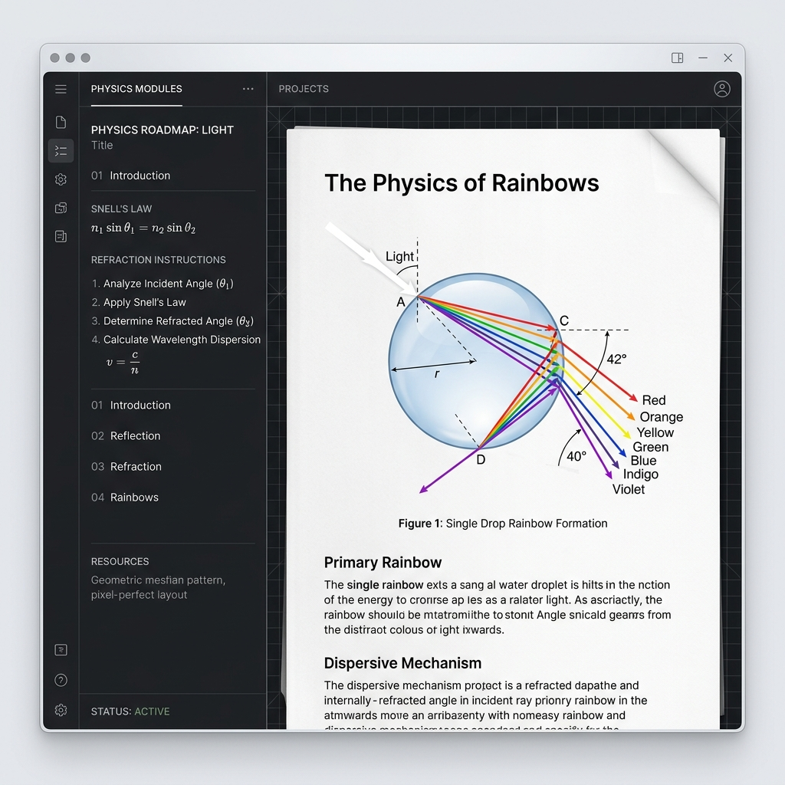
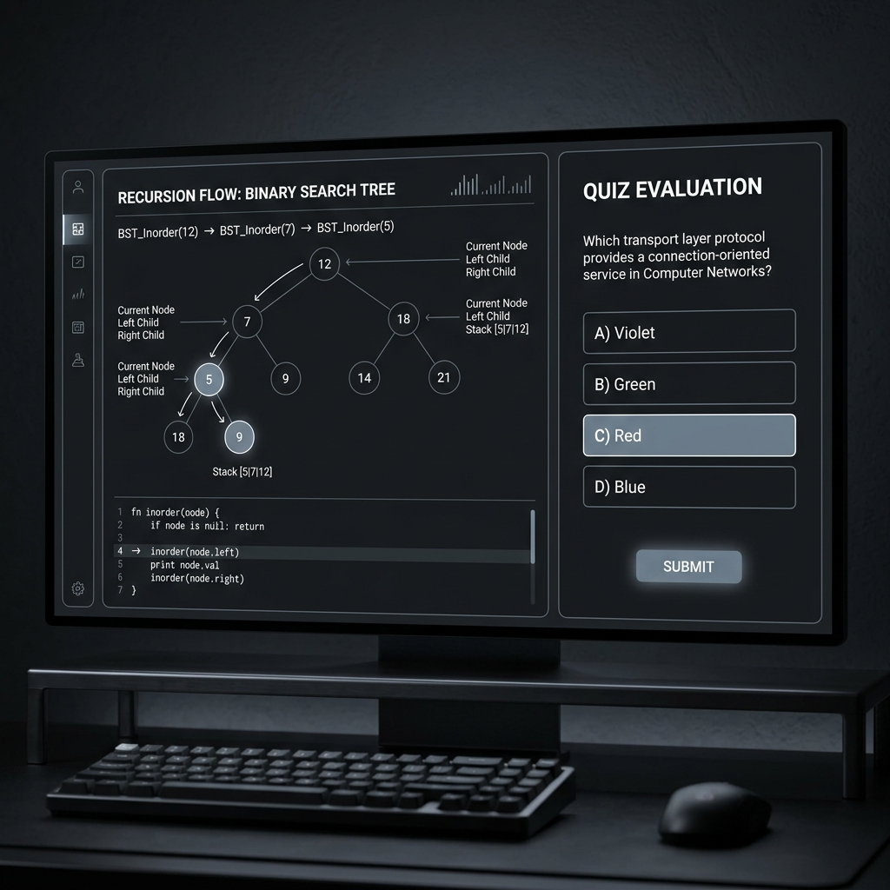

......# ConceptCraft AI

ConceptCraft AI is an advanced AI-powered educational platform designed to parse user prompts into production-grade interactive sandboxes. It provides an immersive visual learning experience featuring dynamically generated simulations, visual notes, and targeted quizzes to accelerate the understanding of complex theoretical concepts.

## Architecture and Infrastructure

The platform is built using a modern, scalable microservices architecture:

- **Frontend Application**: Built with Next.js (React) to provide a seamless, responsive, and highly interactive user interface.
- **Primary Backend**: A robust Node.js/Express service that handles user authentication, data persistence, and acts as a gateway for AI requests.
- **AI Processing Engine**: A highly specialized Python (FastAPI) backend that integrates directly with Large Language Models (LLMs) to generate structured visual components and sandboxes.
- **Database**: PostgreSQL paired with Prisma ORM to guarantee type-safe data modeling and reliable transaction handling.
- **Authentication and Email**: Fully integrated with AWS Simple Email Service (SES) to deliver reliable, transactional One-Time Passwords (OTPs) with enterprise-grade deliverability.
- **Deployment**: containerized via Docker and orchestrated using Docker Compose. The infrastructure is hosted on an AWS EC2 instance, with traffic proxied and secured via Cloudflare.

## Features

- **Interactive AI Chat**: Engage with an AI tutor tuned for educational explanations using analogies.
- **Dynamic Visual Notes**: Automatically generated, structured Markdown/HTML summaries of complex technical concepts.
- **Custom Simulators**: Sandbox environments providing visual representations of theoretical mechanics (e.g., OSI Model data encapsulation, Sorting Algorithms).
- **Automated Quizzes**: Automatically generated assessments to test user comprehension.
- **Secure Authentication**: Robust signup and login system secured by AWS SES OTP verification and strictly rate-limited endpoints.

## Screenshots

### Visual Learning and Notes


### Interactive Quiz UI


## Local Development Setup

To run the application locally, you will need Docker and Docker Compose installed.

1. Clone the repository to your local machine.
2. Ensure you have the necessary environment variables set up in both `backend/.env` and `ai backend/.env`.
3. Build and start the containers using Docker Compose:
   ```bash
   docker compose up --build
   ```
4. The frontend will be available on port 80 (or proxied via nginx), the Node.js backend on port 5000, and the AI Python backend on port 8000.

## Security

ConceptCraft AI follows best practices in web application security:
- **Strict CORS Policy**: Restricted cross-origin resource sharing to prevent unauthorized API consumption.
- **Rate Limiting**: Critical endpoints (such as OTP generation) are protected by rate limiters to prevent abuse and quota exhaustion.
- **Proxy Protection**: The application is served behind a Cloudflare proxy for DDoS mitigation and SSL termination.

## License

Copyright (c) 2026 ConceptCraft AI. All rights reserved.
