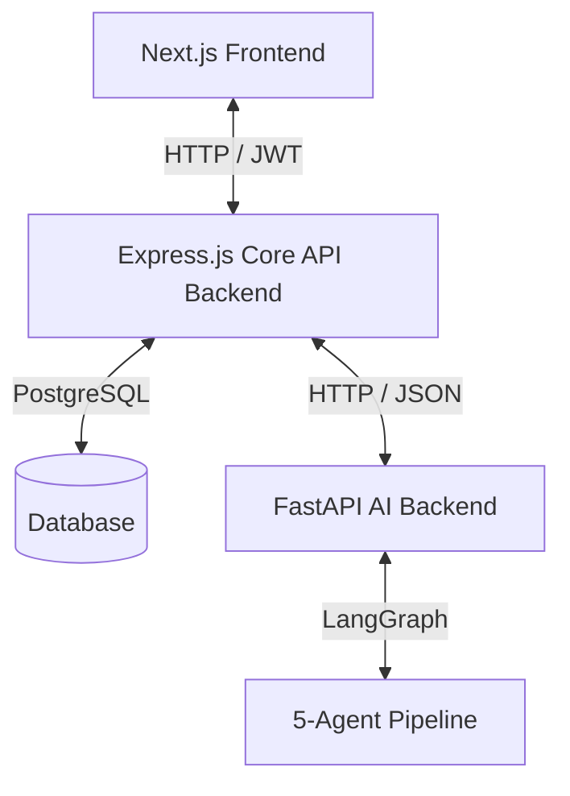

# ConceptCraft AI - Comprehensive Project Context & Execution Plan

## 🎯 Project Overview
**ConceptCraft AI** is an AI-powered visual learning system, smart notes generator, and adaptive quiz engine. It solves the problem of students failing to grasp abstract concepts through plain text or generic videos.
* **The Core Premise:** The human brain processes visuals 60,000× faster than text, yet 99% of study tools are text-based.
* **The Solution:** A multi-agent AI pipeline that decomposes abstract concepts, creates personalized analogies tailored to user interests (e.g., cricket, gaming, cooking), generates side-by-side D3.js browser animations, creates adaptive quizzes, and maintains a user learning roadmap.

---

## 🏗️ Architecture & Services

1. **`/frontend` (Next.js)**
   - UI for user inputs, interactive side-by-side visualizations (abstract vs. analogy), quiz interface, smart notes reader, and learning roadmaps.
2. **`/backend` (Express.js + Prisma/Sequelize)**
   - Core API layer, Handles: User auth (JWT), Role-Based Access Control (RBAC) (3 distinct roles), PostgreSQL schema, AWS SES (welcome/verification emails), and rate limiting. It orchestrates requests to the AI backend.
3. **`/ai backend` (FastAPI + LangGraph + Uvicorn)**
   - Multi-agent stateful service hosting the 5-Agent pipeline:
     1. **Concept Decomposer:** Breaks concept into prerequisite tree + gap analysis.
     2. **Analogy Architect:** Maps concept to user's real-world interests (cricket, gaming, cooking).
     3. **Visualization Generator:** Generates custom D3.js animated visualizations.
     4. **Quiz Architect:** Creates adaptive quizzes (5-10 questions), diagnoses misconceptions.
     5. **Memory & Roadmap:** Updates student's knowledge graph & links curated resources.

---

## 📅 Day-by-Day Execution Timeline (July 10 – July 22, 2026)

### Phase 1: Foundation, Wireframes, Database Schema & Architecture (Due July 13)
* **Day 10 (Fri, Jul 10) - Prep & Directory Setup:**
  - Create monorepo folders: `/backend` (ms1-core-api), `/ai backend` (ms2-vision-agent), `/frontend`, `/infra`, and root README.
  - Setup `.gitignore` to prevent tracking of `node_modules/`, `venv/`, `.env`, etc.
* **Day 11 (Sat, Jul 11) - Design & Concept Coding (Go Heavy):**
  - Draw architecture diagram showing how Express.js fronts auth/DB while FastAPI runs the 5 agents.
  - Sketch wireframes: Landing, Login/Signup, Dashboard, Concept Input, Visualization/Result, Quiz, Notes, Progress/Roadmap, Admin Panel.
  - Draft API contract: Frontend ↔ Express Backend ↔ FastAPI.
  - Start coding LangGraph nodes for **Agent 1 (Decomposer)** and **Agent 2 (Analogy Architect)**.
* **Day 12 (Sun, Jul 12) - Database & AI Graph Completion (Go Heavy):**
  - Design PostgreSQL schema (tables: `users`, `roles`, `concepts`, `concept_requests`, `quiz_attempts`, `quiz_questions`, `weak_areas`, `notes`, `sessions`).
  - Set up PostgreSQL locally.
  - Write **Agent 3 (Visualization Generator)** using D3.js templates + selection logic, **Agent 4 (Quiz Architect)**, and **Agent 5 (Memory & Roadmap)**. Aim for end-to-end local agent code.
* **Day 13 (Mon, Jul 13) - Milestone 1 Submission (Light Day):**
  - Consolidate and push code to GitHub. Verify folders are committed, diagrams/wireframes are uploaded, and README is updated.

---

### Phase 2: Auth, Emails & Basic Agent Integration (Due July 15)
* **Day 14 (Tue, Jul 14) - Core Auth (Moderate Day):**
  - Build custom JWT authentication, signup/login/refresh flow, and RBAC middleware in Express Backend.
  - Wire Express models with Postgres. Integrate AWS SES verification emails. Add rate limiting.
  - Set up Protected Routes in Next.js frontend.
* **Day 15 (Wed, Jul 15) - Milestone 2 Submission (Light Day):**
  - Expose FastAPI endpoint for Agent 1 (Concept Decomposer).
  - Connect Express to FastAPI so Express stores Agent 1's output.
  - Test end-to-end: Signup/Login -> Input concept in Frontend -> Backend calls AI -> Agent 1 output renders on screen.

---

### Phase 3: Complete Agent Graph & Local Pipeline (Due July 17)
* **Day 16 (Thu, Jul 16) - Agent Sequencing (Moderate Day):**
  - Wire Agents 2, 3, 4, 5 into the LangGraph sequence after Agent 1.
  - Implement weak-area tracking in Postgres via Agent 5.
  - Formulate the Smart Notes formatter.
* **Day 17 (Fri, Jul 17) - Milestone 3 Submission (Bug Bash & Integration):**
  - Wire the full local loop: User Input -> 5 Agents process -> UI renders visualizations, notes, quiz, and roadmap.
  - Implement the **Retry Loop:** If Quiz score < 60%, trigger Agents 2 & 3 to regenerate a simpler analogy and simpler visualization.
  - Lock admin stats endpoints behind RBAC. Run a full local bug bash.

---

### Phase 4: Dockerization, Deployment & Infrastructure (Due July 20)
* **Day 18 (Sat, Jul 18) - Containerization & Server Setup (Go Heavy):**
  - Write Dockerfiles for core Express API and FastAPI AI service.
  - Write a `docker-compose.yml` including local PostgreSQL.
  - Provision an EC2 instance, install Docker, and launch services using docker-compose.
  - Link custom domain DNS to the EC2 instance.
* **Day 19 (Sun, Jul 19) - NGINX & Production Config (Go Heavy):**
  - Set up NGINX reverse proxy for frontend and APIs.
  - Configure SSL certificates using Let's Encrypt (Certbot).
  - Deploy Next.js frontend (EC2 or Vercel linked to backend).
  - Verify production AWS SES.
  - Add basic OpenTelemetry instrumentation (spans and metrics).
* **Day 20 (Mon, Jul 20) - Milestone 4 Submission (Light Day):**
  - Test production system end-to-end: live URL signup -> confirmation email -> login -> concept run -> quiz -> notes -> roadmap.
  - Resolve CORS/env issues.

---

### Phase 5: Productionization, Load Tests & Final Prep (Due July 21-22)
* **Day 21 (Tue, Jul 21) - Milestone 5 Submission (Polishing):**
  - Complete OpenTelemetry dashboards. Measure per-agent latencies.
  - Run load tests to determine scaling limits.
  - Generate Swagger/OpenAPI documentation.
  - Document edge cases and limitations.
* **Day 22 (Wed, Jul 22) - Evaluation & Final Demo (190 points):**
  - Rehearse slide deck and prepare backup screen recording of the full flow.
  - Final checks on the live site.

---

## ⚡ Crucial Risks & Mitigation Plans

1. **D3.js Visualization Reliability (High Risk):**
   - *Risk:* Real-time LLM-generated custom D3.js code is highly prone to syntax errors or rendering failures.
   - *Mitigation:* If behind schedule by Day 12/13, switch to a template-driven approach: compile a small library of standard, robust D3.js templates. Have the LLM select the template and inject data/labels into it.
2. **Google OAuth & Rich Docs:**
   - Keep Google OAuth and detailed OpenAPI docs as optional features. Implement only after the core agentic workflow is completely robust.
3. **Microservices Justification:**
   - Be ready to explain why we use 2 backends: Express.js serves standard API endpoints (JWT, DB, mail) with low overhead, while FastAPI handles stateful, long-running Python LangGraph execution.

---

## 📖 Mentor Evaluation Criteria Checklist

- [ ] **AI Agentic Use Case (25 pts):** Clear explanation of the 5 agents, the LangGraph state flow, and the conditional quiz retry loop (score < 60%).
- [ ] **Understanding of Code (30 pts):** Direct familiarity with DB schemas, file structures, and the Express ↔ FastAPI interaction contract.
- [ ] **Functionality (30 pts):** Completely bug-free flow on a clean user account (Signup -> Concept -> AI -> Quiz -> Roadmap).
- [ ] **Usability and UI (25 pts):** Sleek, highly responsive UI. No default/unstyled HTML.
- [ ] **Production Readiness (25 pts):** Live URL over HTTPS, OpenTelemetry statistics ready, and documented known limitations.

---

## 📝 Change Log & Session Progress

### 2026-07-11 (Saturday)
- **Active Phase:** Phase 1 (Milestone 1 prep)
- **Actions Completed:**
  - Initialized `.gitignore` in root directory.
  - Created Python virtual environment in `/ai backend/venv`.
  - Installed `fastapi` and `uvicorn` inside the python virtual environment.
- **Current Status:** FastAPI is successfully installed inside the virtual environment. Terminal is ready for writing the first python API.
