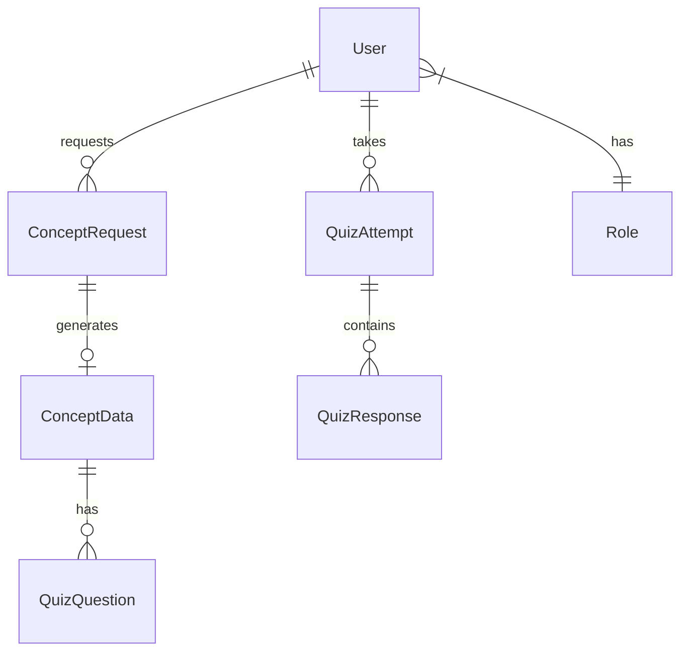

# ConceptCraft AI - Database Schema Design (PostgreSQL)

This schema design outlines the tables required in PostgreSQL to store users, roles, concepts, quizzes, and learning roadmaps.



---

## 📋 Table Definitions

### 1. `users`
Stores user profile information and credentials.
```sql
CREATE TABLE users (
    id VARCHAR(255) PRIMARY KEY,
    name VARCHAR(255) NOT NULL,
    email VARCHAR(255) UNIQUE NOT NULL,
    password_hash VARCHAR(255) NOT NULL,
    role_id INT NOT NULL REFERENCES roles(id),
    interests TEXT[], -- Array of interests (e.g. ['cricket', 'gaming'])
    created_at TIMESTAMP DEFAULT CURRENT_TIMESTAMP,
    updated_at TIMESTAMP DEFAULT CURRENT_TIMESTAMP
);
```

### 2. `roles`
Stores access levels (e.g. `ADMIN`, `STUDENT`, `GUEST`).
```sql
CREATE TABLE roles (
    id SERIAL PRIMARY KEY,
    name VARCHAR(50) UNIQUE NOT NULL
);
```

### 3. `concepts`
Stores cached concepts that have been processed by the AI pipeline.
```sql
CREATE TABLE concepts (
    id VARCHAR(255) PRIMARY KEY,
    name VARCHAR(255) UNIQUE NOT NULL, -- e.g. "Binary Search"
    description TEXT,
    prerequisites TEXT[],
    created_at TIMESTAMP DEFAULT CURRENT_TIMESTAMP
);
```

### 4. `concept_requests`
Tracks personalized requests from individual users (each user gets a customized analogy based on interest).
```sql
CREATE TABLE concept_requests (
    id VARCHAR(255) PRIMARY KEY,
    user_id VARCHAR(255) REFERENCES users(id) ON DELETE CASCADE,
    concept_id VARCHAR(255) REFERENCES concepts(id) ON DELETE CASCADE,
    analogy_interest VARCHAR(255) NOT NULL, -- e.g. "cricket"
    analogy_content TEXT NOT NULL,          -- The custom analogy text
    d3_visualization_json JSONB NOT NULL,   -- Config for D3.js rendering
    smart_notes TEXT NOT NULL,              -- Markdown formatted notes
    roadmap_resource_links JSONB NOT NULL,  -- Links suggested by memory agent
    created_at TIMESTAMP DEFAULT CURRENT_TIMESTAMP
);
```

### 5. `quiz_questions`
Stores questions generated by the AI for a specific concept request.
```sql
CREATE TABLE quiz_questions (
    id VARCHAR(255) PRIMARY KEY,
    concept_request_id VARCHAR(255) REFERENCES concept_requests(id) ON DELETE CASCADE,
    question_text TEXT NOT NULL,
    options JSONB NOT NULL, -- e.g. {"A": "Option 1", "B": "Option 2"}
    correct_option VARCHAR(10) NOT NULL,
    explanation TEXT NOT NULL
);
```

### 6. `quiz_attempts`
Tracks a user's performance on a quiz.
```sql
CREATE TABLE quiz_attempts (
    id VARCHAR(255) PRIMARY KEY,
    user_id VARCHAR(255) REFERENCES users(id) ON DELETE CASCADE,
    concept_request_id VARCHAR(255) REFERENCES concept_requests(id) ON DELETE CASCADE,
    score INT NOT NULL, -- Percentage (0-100)
    passed BOOLEAN NOT NULL, -- e.g. score >= 60
    created_at TIMESTAMP DEFAULT CURRENT_TIMESTAMP
);
```

### 7. `weak_areas`
Tracks areas where the student is struggling, updated by the memory agent.
```sql
CREATE TABLE weak_areas (
    id SERIAL PRIMARY KEY,
    user_id VARCHAR(255) REFERENCES users(id) ON DELETE CASCADE,
    concept_id VARCHAR(255) REFERENCES concepts(id) ON DELETE CASCADE,
    misconception_tag VARCHAR(255) NOT NULL, -- Specific error identified
    attempt_count INT DEFAULT 1,
    resolved BOOLEAN DEFAULT FALSE,
    updated_at TIMESTAMP DEFAULT CURRENT_TIMESTAMP
);
```
