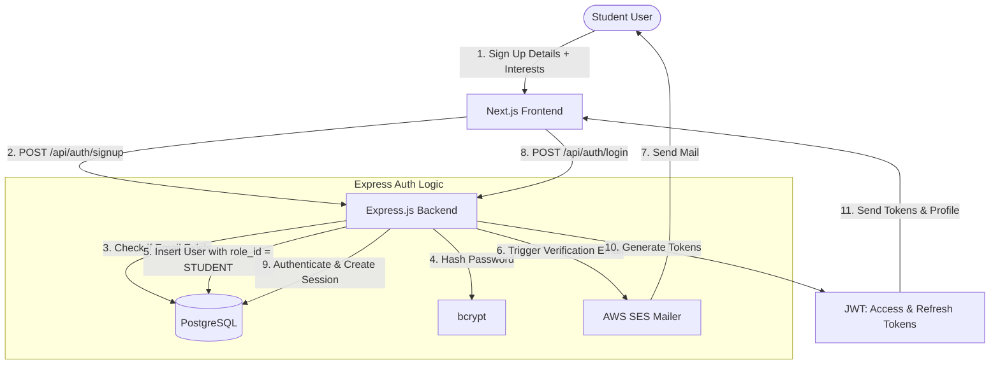
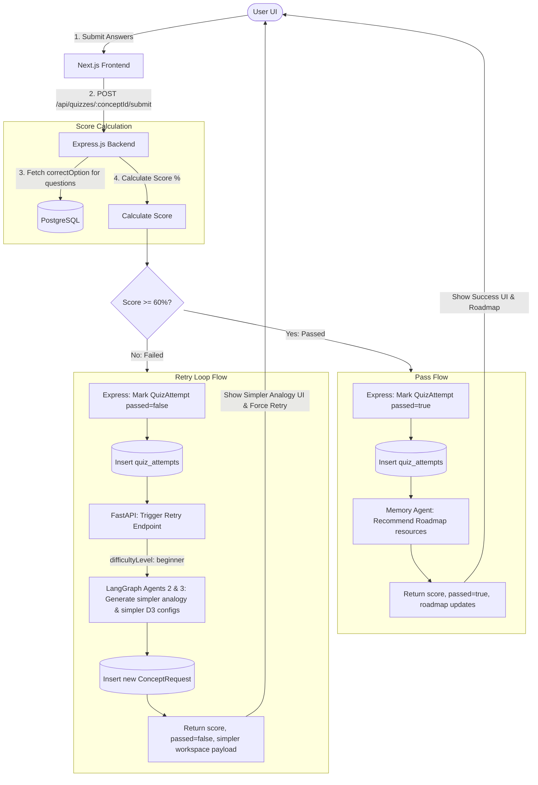
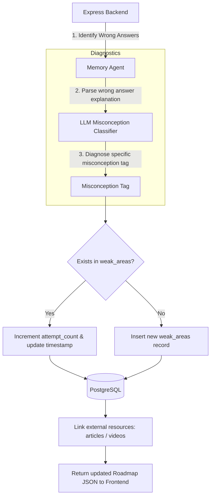

# ConceptCraft AI - Architecture & Workflows Diagram Code

Here is the complete list of system workflows and the respective **Mermaid.js Diagram-as-Code** snippets. You can copy these code blocks and paste them directly into the diagram-as-code editor of **Eraser.io** (or any Mermaid-enabled markdown renderer) to generate clean flowcharts.

---

## 🔑 Workflow 1: Onboarding, Auth & Interest Registration
This workflow covers user registration, selecting personal interests, setting the role, and issuing tokens.

### Mermaid.js Code:


---

## 🧠 Workflow 2: Concept Generation (The 5-Agent Pipeline)
This represents the core AI execution flow when a user requests a new concept (e.g. "Binary Search" with interest "Cricket").

### Mermaid.js Code:
```mermaid
graph TD
    FE[Next.js Frontend] -->|1. POST /api/concepts/generate| BE[Express.js Backend]
    
    subgraph Express.js Verification
        BE -->|2. Validate JWT| Token[Access Token Val]
        BE -->|3. Check Cache: concepts table| DB[(PostgreSQL)]
    end
    
    Token -->|4. Forward Payload| FA[FastAPI AI Backend]
    
    subgraph FastAPI LangGraph Pipeline
        FA -->|Node 1| A1[Concept Decomposer: Breaks into prerequisites]
        A1 -->|Node 2| A2[Analogy Architect: Map to interests]
        A2 -->|Node 3| A3[Viz Generator: Create D3.js configurations]
        A3 -->|Node 4| A4[Quiz Architect: Generate 5-10 adaptive MCQs]
        A4 -->|Node 5| A5[Memory & Roadmap: Setup student graph]
    end
    
    A5 -->|5. Return Full JSON Payload| BE
    
    subgraph DB Persistence

 bash
 bashbackend
 bashai backend
 bashfrontend
 main*
 0 
 38
 SecureCoder
Antigravity - Settings
docs se project ka contest llo and tum kuch karn anhi project mai bnao unka khud tum mujhe mistake and guid karn aok
direct cod edo yar
14:41


यहाँ सभी 4 Workflows के Mermaid.js Diagram-as-Code हैं, जिन्हें आप सीधे कॉपी करके Eraser.io में डाल सकते हैं:

1. Onboarding, Auth & Interest Flow (रजिस्ट्रेशन और लॉगिन)
mermaid


graph TD
    User([Student User]) -->|1. Sign Up Details + Interests| FE[Next.js Frontend]
    FE -->|2. POST /api/auth/signup| BE[Express.js Backend]
    
    subgraph Express Auth Logic
        BE -->|3. Check if Email Exists| DB[(PostgreSQL)]
        BE -->|4. Hash Password| Crypt[bcrypt]
        BE -->|5. Insert User with role_id = STUDENT| DB
        BE -->|6. Trigger Verification Email| SES[AWS SES Mailer]
    end
    
    SES -->|7. Send Mail| User
    FE -->|8. POST /api/auth/login| BE
    BE -->|9. Authenticate & Create Session| DB
    BE -->|10. Generate Tokens| JWT[JWT: Access & Refresh Tokens]
    JWT -->|11. Send Tokens & Profile| FE
2. 5-Agent Concept Generation Flow (AI पाइपलाइन)
mermaid


graph TD
    FE[Next.js Frontend] -->|1. POST /api/concepts/generate| BE[Express.js Backend]
    
    subgraph Express.js Verification
        BE -->|2. Validate JWT| Token[Access Token Val]
        BE -->|3. Check Cache: concepts table| DB[(PostgreSQL)]
    end
    
    Token -->|4. Forward Payload| FA[FastAPI AI Backend]
    
    subgraph FastAPI LangGraph Pipeline
        FA -->|Node 1| A1[Concept Decomposer: Breaks into prerequisites]
        A1 -->|Node 2| A2[Analogy Architect: Map to interests]
        A2 -->|Node 3| A3[Viz Generator: Create D3.js configurations]
        A3 -->|Node 4| A4[Quiz Architect: Generate 5-10 adaptive MCQs]
        A4 -->|Node 5| A5[Memory & Roadmap: Setup student graph]
    end
    
    A5 -->|5. Return Full JSON Payload| BE
    
    subgraph DB Persistence
        BE -->|6. Insert Concept & ConceptRequest| DB
        BE -->|7. Insert QuizQuestions| DB
    end
    
    BE -->|8. Return Workspace JSON| FE
    FE -->|9. Render Chat & Visual Canvas| User([User UI])
3. Quiz Submission & 60% Retry Loop (क्विज और फेलियर लूप)
mermaid


graph TD
    User([User UI]) -->|1. Submit Answers| FE[Next.js Frontend]
    FE -->|2. POST /api/quizzes/:conceptId/submit| BE[Express.js Backend]
    
    subgraph Score Calculation
        BE -->|3. Fetch correctOption for questions| DB[(PostgreSQL)]
        BE -->|4. Calculate Score %| Calc[Calculate Score]
    end
    
    Calc --> ScoreCheck{Score >= 60%?}
    
    ScoreCheck -->|Yes: Passed| PassFlow
    ScoreCheck -->|No: Failed| FailFlow
    
    subgraph PassFlow [Pass Flow]
        BE1[Express: Mark QuizAttempt passed=true] --> DB1[(Insert quiz_attempts)]
        DB1 --> Road[Memory Agent: Recommend Roadmap resources]
        Road --> FEPass[Return score, passed=true, roadmap updates]
    end
    
    subgraph FailFlow [Retry Loop Flow]
        BE2[Express: Mark QuizAttempt passed=false] --> DB2[(Insert quiz_attempts)]
        DB2 --> FA[FastAPI: Trigger Retry Endpoint]
        FA -->|difficultyLevel: beginner| Agents[LangGraph Agents 2 & 3: Generate simpler analogy & simpler D3 configs]
        Agents --> DB3[(Insert new ConceptRequest)]
        DB3 --> FEFail[Return score, passed=false, simpler workspace payload]
    end
    
    FEPass -->|Show Success UI & Roadmap| User
    FEFail -->|Show Simpler Analogy UI & Force Retry| User
4. Memory Agent & Weak Areas Tracking (कमियों की पहचान)
mermaid


graph TD
    BE[Express Backend] -->|1. Identify Wrong Answers| Mem[Memory Agent]
    
    subgraph Diagnostics
        Mem -->|2. Parse wrong answer explanation| LLM[LLM Misconception Classifier]
        LLM -->|3. Diagnose specific misconception tag| Tag[Misconception Tag]
    end
    
    Tag --> DBCheck{Exists in weak_areas?}
    
    DBCheck -->|Yes| UpdateWA[Increment attempt_count & update timestamp]
    DBCheck -->|No| InsertWA[Insert new weak_areas record]
    
    UpdateWA --> DB[(PostgreSQL)]
    InsertWA --> DB
    
    DB --> LinkGen[Link external resources: articles / videos]
    LinkGen --> FE[Return updated Roadmap JSON to Frontend]
14:41



yaar tum basic auth ka bnao pahle  flwo chart
14:47


यहाँ Basic Auth (Signup & Login) का एकदम विस्तृत और सटीक Mermaid.js Diagram-as-Code है। इसमें पासवर्ड हैशिंग, डेटाबेस वेरिफिकेशन, एरर केसेस, और JWT टोकन जनरेशन के सभी स्टेप्स शामिल हैं:

mermaid


graph TD
    %% Signup Flow
    subgraph User Signup Flow
        StartSignup([Start Signup]) --> InputSignup[User inputs: Name, Email, Password, Interests]
        InputSignup --> SendSignup[POST /api/auth/signup]
        SendSignup --> CheckEmail{Email exists in DB?}
        
        CheckEmail -->|Yes| ErrEmail[Return 400: Email already registered]
        CheckEmail -->|No| HashPass[Hash password using bcrypt]
        
        HashPass --> GetStudentRole[Get role_id for STUDENT from Roles table]
        GetStudentRole --> DBInsert[Insert User into users table with hashed password & interests]
        DBInsert --> WelcomeEmail[Trigger Welcome Email via AWS SES]
        WelcomeEmail --> ResSignup[Return 201: Registered successfully]
    end
    %% Login Flow
    subgraph User Login Flow
        StartLogin([Start Login]) --> InputLogin[User inputs: Email, Password]
        InputLogin --> SendLogin[POST /api/auth/login]
        SendLogin --> QueryUser{Find User by Email in DB?}
        
        QueryUser -->|Not Found| ErrAuth[Return 401: Invalid credentials]
        QueryUser -->|Found| CompPass{bcrypt.compare password?}
        
        CompPass -->|No Match| ErrAuth
        CompPass -->|Match| GenJWT[Generate JWT Access Token - 15m & Refresh Token - 7d]
        
        GenJWT --> SaveSession[Insert Refresh Token & expiresAt into sessions table]
        SaveSession --> ResLogin[Return 200: Send accessToken, refreshToken & user profile]
 
        BE -->|6. Insert Concept & ConceptRequest| DB
        BE -->|7. Insert QuizQuestions| DB
    end
    
    BE -->|8. Return Workspace JSON| FE
    FE -->|9. Render Chat & Visual Canvas| User([User UI])
```

---

## 🔁 Workflow 3: Quiz Submission & The 60% Retry Loop
This flowchart maps what happens when a student takes the quiz. It handles the conditional split for pass (score >= 60%) or retry (score < 60%).

### Mermaid.js Code:


---

## 📈 Workflow 4: Memory Agent & Weak Areas Tracking
This flow details how the Memory Agent analyzes incorrect quiz responses to update the user's weaknesses and update their roadmap.

### Mermaid.js Code:

