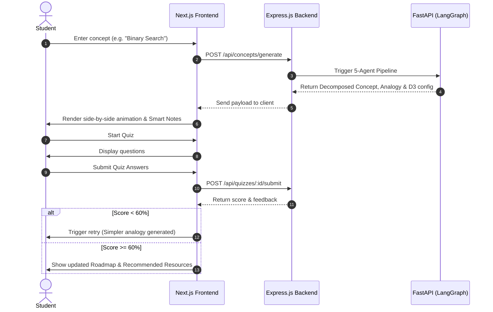

# Product Requirement Document (PRD) - ConceptCraft AI

## 1. Executive Summary & Vision
ConceptCraft AI is an EdTech platform that replaces standard text-based explanations and generic video content with personalized visual animations and adaptive quizzes. 

### Core Value Proposition
"Type any concept. Get a personalized animation with analogy, smart notes, adaptive quiz & resource recommendations. Understand it in 2 minutes."

---

## 2. Problem Statement & User Persona
* **The Problem:** 
  - Students read abstract concepts (across Science, Mathematics, Biology, Chemistry, Computer Science, History, and more) multiple times without comprehension.
  - LLMs output long walls of text, which mimics the static medium that already failed them.
  - Video content is generic and does not connect to the user's specific context or interest.
  - Quizzes are static and do not diagnose the exact misconception.
* **Primary Persona:** Students and self-learners of any academic discipline looking for intuitive, fast ways to grasp complex concepts.

---

## 3. Core Features & Functional Requirements

### 3.1. User Onboarding & Auth
* **Interests Collection:** During signup/profile edit, users select or input 2-3 real-world interests (e.g., Cricket, Gaming, Cooking, Photography).
* **RBAC (Role-Based Access Control):** 
  - `STUDENT`: Normal exploration, quizzes, notes.
  - `ADMIN`: View system-wide stats and latency metrics.

### 3.2. Multi-Agent AI Pipeline (The 5-Agent Engine)
The core backend initiates a 5-step agent execution flow using LangGraph:

1. **Concept Decomposer:**
   - Breaks the requested topic (e.g., "Recursion") into prerequisites.
   - Outputs a tree of dependencies.
2. **Analogy Architect:**
   - Maps the concept to the user's registered interests (e.g., Cricket: "Recursion is like the umpire reviewing runs step-by-step back to the original ball").
3. **Visualization Generator:**
   - Generates/selects a robust D3.js animated configuration to display the concept and analogy running in parallel side-by-side.
4. **Quiz Architect:**
   - Creates a 5-10 question adaptive quiz targeting key areas of the concept.
   - Adjusts question difficulty in real-time based on previous answers.
5. **Memory & Roadmap Agent:**
   - Analyzes quiz mistakes to pinpoint the exact misconception.
   - Updates the user's knowledge graph and recommends external resources (articles, video links).

### 3.3. The Retry Loop
* If a user scores **under 60%** on the quiz, the system must trigger a retry sequence.
* It regenerates the explanation with a **simpler analogy** and **simpler visualization layout** rather than repeating the same content.

---

## 4. User Journey Map

---

## 5. Non-Functional Requirements (NFRs)

* **Performance & Latency:** 
  - The multi-agent LLM pipeline must compile and respond in under 5 minutes.
  - Frontend must use interactive skeleton loading states so the user feels active progress.
* **Security:** 
  - Double token JWT auth (Access & Refresh tokens).
  - Rate limiting on Auth routes (max 5 login attempts per 15 minutes) and API request routes.
* **Observability:** 
  - Integration of OpenTelemetry spans to track the speed/latency of each individual agent inside FastAPI.
